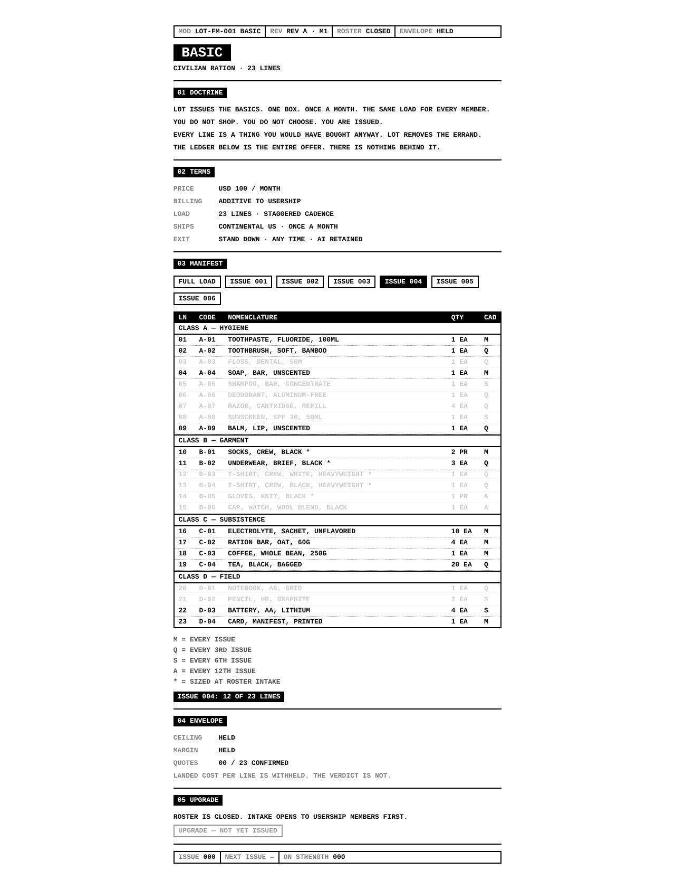

# LOT-FM-001 SESSION REPORT — M1 / S1

```
DATE      2026-11-11
MODULE    BASIC (RATION)
PHASE     MONTH 1 — LEDGER & DOCTRINE
BRANCH    claude/beautiful-johnson-59if55
STATUS    GREEN
ENVELOPE  PEAK 39.85 / CEILING 40.00 · MARGIN 60.2% (PEAK) / 62.0% (AVG)
```

**ONE LINE:** Basics tab live as a read-only OPEN TAB; 23-line ledger, doctrine,
terms and status line issued; envelope held at USD 39.85 peak.

## 1. WHAT WAS BUILT

| Item | Detail |
|---|---|
| Route | `/basics`. Members get it inside the app (new `basics` route + TabPanel). Strangers get a standalone public entry (`src/client/entries/basics.tsx`) — no login wall. |
| Nav | "Basics" button was a dead placeholder (`opacity-30`). Now active, logged-in and logged-out. Logged-out click hard-navigates to `/basics`. |
| Manifest | `src/shared/constants/basics.ts`: 23 lines in 4 classes (A HYGIENE, B GARMENT, C SUBSISTENCE, D FIELD), each with code, nomenclature, qty, cadence (M/Q/S/A) and phase. `getIssueLoad(n)` returns the lines due on issue n. |
| COGS | `src/server/utils/basics-cogs.ts`: per-line landed estimates + box overhead (carton 0.90, postage 6.50). Server only. Never serialized per line. |
| API | `GET /api/public/basics` → doctrine, terms, manifest, envelope verdict (ceiling/margin HELD or BREACH, quotes confirmed, manifest intact), roster state. 5-min cache. |
| UI | `src/client/components/Basics.tsx`: status line, title, 01 DOCTRINE, 02 TERMS, 03 MANIFEST (ledger + ISSUE 001–006 load preview), 04 ENVELOPE, 05 UPGRADE (disabled until Month 2), closing status line. |
| Style | `.lot-term` in `index.css`: Liberation Mono bold stack, uppercase, ink/ground from theme tokens, inversion-only hierarchy, 2px rules, square corners, character-grid columns. Phone layout drops the CODE column. |
| Gate | `yarn basics:check` — audits manifest (23 lines, order, codes, cadence/phase, COGS rows) and fails on any box > USD 40 or margin < 60%. |

## 2. ENVELOPE (12-ISSUE CYCLE)

```
ISSUE  LINES  LANDED
001    12     39.05
002    11     39.05
003    11     36.25
004    12     39.55
005    10     35.05
006    10     35.85
007    12     39.05
008    11     39.05
009    11     36.25
010    12     39.55
011    11     38.55
012    11     39.85   ← PEAK
AMORTIZED  38.09   MARGIN 62.0%
QUOTED     0/23
```

First draft breached (peak 56.65, issue 006). Corrected by: soap 2→1, socks
3→2 PR, ration bar 6→4, underwear M→Q (3 EA), shampoo Q→S, sweatshirt (14.00)
replaced by knit gloves (3.50), and re-phasing Q/S/A lines so heavy lines never
share a box.

## 3. VERIFICATION

- `yarn client:build` — PASS (new `basics.js` entry emitted)
- `yarn server:build` — PASS, no new errors
- `tsc --noEmit` (client) — 104 errors before, 104 after; none in touched code (pre-existing debt)
- `yarn basics:check` — GREEN
- Playwright, desktop 1280 + iPhone 13: renders, no page errors, no horizontal scroll, ISSUE 004 filter dims off-load lines



## 4. DECISIONS

- The LOT-FM-001 manual text (Section 2 cadence, the 23 items) was not in the
  repo. The ledger is a **first-draft load authored to fit the envelope**.
  Needs S-2 sign-off on lines and nomenclature.
- Ink/ground use the user's theme pair rather than hard white/black, so the tab
  does not break custom themes. Default theme = white ground / black ink.
- `getIssueLoad` (strictly Month 3 work) built now: the envelope cannot be
  honestly verified without per-box loads.

## 5. NEXT SESSION

1. S-2 review of the ledger.
2. Self-host LiberationMono-Bold; OG meta for `/basics`.
3. Wire `basics:check` into pre-deploy.
4. Begin Month 2: `BasicsEnrollment` model + state machine.

**ELIMINATED DISTRACTION:** sweatshirt line (USD 14.00, broke every box it touched).

See `docs/basics/LOT-FM-001-PLAN.md` for the full 90-day checklist.
