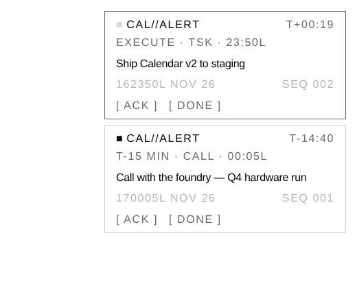

# LOT-SR-20261116-CALENDAR-01 — Calendar Widget v2: Time · Status · Alerts

```
┌──────────────────────────────────────────────────────────────────────┐
│ SESSION REPORT            LOT-SR-20261116-CALENDAR-01                │
│ DTG                       162350L NOV 26                             │
│ BRANCH                    claude/dreamy-babbage-mwrtww               │
│ MODE                      SCHEDULED ROUTINE · AUTONOMOUS             │
│ STATUS                    GREEN · PUSHED                             │
└──────────────────────────────────────────────────────────────────────┘
```

## 01 · OBJECTIVE

Make the Calendar widget reliable: track time, log its lifecycle into the
Log, and fire terminal-grade ("military") event notifications. Keep the
minimalist UI.

## 02 · STARTING STATE (foundation found)

| Item | State before session |
|---|---|
| Entries | `calendar_entry` logs with `date`, `text`, `entryType` — **no time** |
| Status | none — entries could not be completed or removed |
| Notifications | none |
| Month grid | `dayjs().year(y).month(m)` — **overflow bug** when today's day-of-month doesn't exist in the target month (e.g. on the 31st, navigating to a 30-day month jumped a month) |
| Upcoming list | keyed by array index; past tasks vanished at midnight |

## 03 · WHAT SHIPPED

### 3.1 Time tracking
- Optional **24h time** field (`HH:MM`) next to the entry text. Loose input
  accepted: `930`, `9:30`, `0930`, `21` → normalized; invalid input is
  rejected inline, empty = all-day.
- Header shows the next timed entry: `NEXT 14:30 · T-4H 15M`.
- Upcoming rows show time; open **tasks/calls** stay visible for 7 days as
  `OVERDUE` instead of disappearing. Past notes expire as before.

### 3.2 Status (append-only, via the Log)
Click any upcoming entry (or see the selected date's list) → `Done` / `Cancel`.
No log is mutated; status is derived from the latest closing record.

| Event | Written when | Metadata |
|---|---|---|
| `calendar_entry` | entry added | `date, time, text, entryType` (`time` new) |
| `calendar_done` | entry marked done | `entryId, date, time, text, entryType` |
| `calendar_cancel` | entry scrubbed | same |
| `calendar_alert` | EXECUTE / DAY-OF alert fires | `entryId, stage, date, time, text, entryType, firedAt` |

All three new events were added to the `/api/logs` displayable whitelist and
get their own renderers in `Logs.tsx` (`CAL//ALERT:` / `CAL:` blocks with
`EXECUTE · DONE · SCRUB · DAY OF` status). Status updates are optimistic and
roll back if the write fails.

### 3.3 Alerts



| Stage | Fires at | Logged | Card behaviour |
|---|---|---|---|
| `T-15 MIN` | 15 min before a timed entry | no (transient) | self-clears after 60 s |
| `EXECUTE` | the entry's time | yes → `calendar_alert` | **holds until ACK/DONE**, blinking ■ |
| `DAY OF` | 09:00 local on an all-day entry | yes → `calendar_alert` | self-clears after 60 s |

Card anatomy: `■ CAL//ALERT` + live signed countdown (`T-14:40` / `T+00:19`),
stage · type code (`TSK`/`CALL`/`NOTE`) · `HH:MML`, the entry text, a
military date-time group (`162350L NOV 26`) and a sequence number. Actions:
`[ ACK ]`, `[ DONE ]` (tasks/calls). Max 3 visible, the rest shown as
`+N QUEUED`. Respects `prefers-reduced-motion`.

Extras:
- Square-wave pips (2 for pre/day, 3 high for EXECUTE) — **only when LOT
  sound is on** (`isSoundOn`).
- OS notification when permission is granted; an `Enable system alerts`
  link appears in the open calendar while permission is undecided. No
  prompt is ever shown unprompted.

### 3.4 Reliability rules
- **Dedup across reloads and devices**: fired keys (`entryId:stage`) are
  kept in a localStorage ledger *and* re-derived from `calendar_alert`
  logs, so a second device won't re-log an alert already recorded.
- **No stacking**: if both pre and EXECUTE are due (app opened late), only
  the latest stage fires.
- **Missed-alert grace 2 h**: alerts missed while the app was closed fire
  once if within 2 h, otherwise drop silently (no flood on open).
- **Never alert for the past**: stages scheduled before the entry was
  created are skipped (e.g. adding an all-day entry for today at 14:00 does
  not fire a 09:00 alert).
- Scheduler waits for the first log load, ticks every 15 s, re-checks on tab
  focus, and arms a precise timeout for the next alert so it lands on the
  second rather than on the tick.
- Cards auto-drop when their entry is closed elsewhere.
- Month grid rebuilt from an explicit `Date(y, m, 1)` — overflow bug fixed.

## 04 · FILES

| File | Change |
|---|---|
| `src/client/utils/calendar.ts` | **new** — pure core: parsing, status, schedule, `dueAlerts`, countdowns, DTG, grid, fired ledger |
| `src/client/components/CalendarAlert.tsx` | **new** — alert stack, pips, OS notification |
| `src/client/components/CalendarWidget.tsx` | rewritten on top of the core; same layout and copy |
| `src/client/components/Logs.tsx` | renderers for `calendar_alert/done/cancel`; entry shows text + time |
| `src/server/routes/api.ts` | 3 events added to displayable whitelist |
| `scripts/tests/test-calendar.ts` | **new** — 40 checks; `npm run test:calendar` |

## 05 · VERIFICATION

| Check | Result |
|---|---|
| `npm run test:calendar` | **40 / 40 PASS** (time parsing, date validity, grid for Feb/Aug/Nov/2027, status, all alert stages, dedup, no-stack, grace expiry, late-created suppression, countdowns) |
| `tsc --noEmit` (client) | 104 errors before → 104 after; **0 in touched/new files** (all pre-existing in `badges.ts`, `Logs.tsx` L99–3882) |
| `tsc --noEmit` (server) | 0 → 0 |
| `npm run client:js:build` | completed |
| Visual (Playwright, standalone harness) | alert stack renders as shown above, light theme |

Not verified this session: the full app end-to-end against a live DB
(no database in the routine container), dark theme rendering, and the OS
notification path on a real browser.

## 06 · NEXT SESSION — CANDIDATES

1. Mount the alert scheduler at the app root so alerts also fire off the
   System tab (currently the widget must be mounted — it is on System).
2. Snooze (`+10 MIN`) on EXECUTE cards, logged as `calendar_snooze`.
3. Edit/reschedule an entry (append `calendar_entry` with `supersedes`).
4. Recurrence (daily / weekly) for tasks and calls.
5. Time tracking proper: `[ START ]` on an EXECUTE card → elapsed timer →
   `calendar_done` carries `durationMin`.
6. Dark-theme + phone-width screenshot pass.

## 07 · LEXICON

- **EXECUTE** — the T-0 alert stage; the only stage that holds until acknowledged.
- **SCRUB** — a cancelled entry.
- **DTG** — date-time group, `DDHHmmL MON YY`, local time.
- **Fired ledger** — `lot_calendar_alerts_v1`, dedup keys `entryId:stage`.
