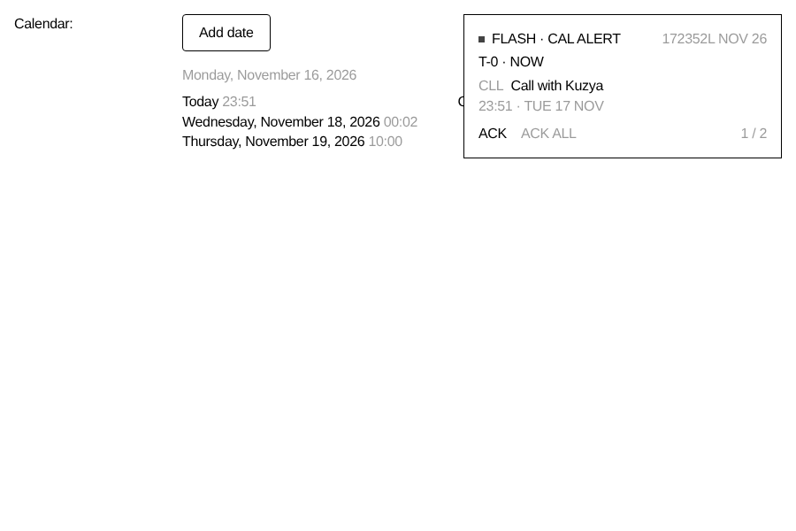
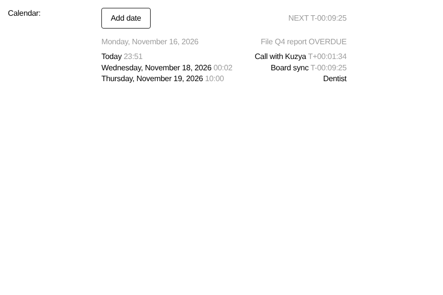
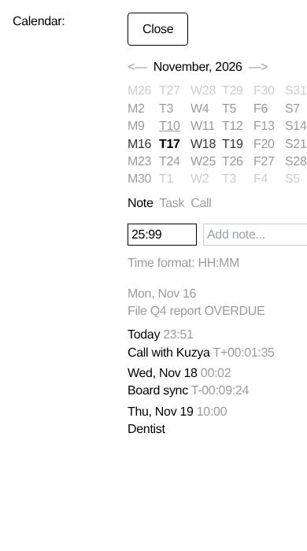

# SESSION REPORT — CALENDAR WIDGET v2 · TIME TRACKING + ALERT GRID
## Date: 2026-11-17 · Branch: `claude/dreamy-babbage-mc3zw1`
### Session Type: Scheduled routine — autonomous engineering (Calendar widget)

```
╔══════════════════════════════════════════════════════════════════╗
║  LOT SYSTEMS CORPORATION — SESSION REPORT                       ║
║  LOT-SR-20261117-CAL-01 · CALENDAR WIDGET v2                    ║
║  STATUS: GREEN · BUILD PASS · ENGINE TEST 8/8                   ║
╚══════════════════════════════════════════════════════════════════╝
```

---

## 1. MISSION

> Continue the Calendar widget. Keep the minimalist UI. Make it a reliable
> widget that tracks time and logs into Log, with military-grade event
> notifications.

**Base state entering session:** `CalendarWidget.tsx` (281 lines). It handled
date-only Note / Task / Call entries, read from `/api/logs`, and wrote
`calendar_entry` logs. It had no times, no notifications, and no way to
complete or cancel an entry.

---

## 2. SITREP — DEFECTS FOUND IN FOUNDATION

| # | Defect | Severity | Fix |
|---|--------|----------|-----|
| D1 | Entries came from `/api/logs`, which is capped at **500 rows** across ~150 event types. Once background jobs filled that window, scheduled entries silently disappeared from the widget. | HIGH (reliability) | New dedicated `GET /api/calendar` stream that returns only calendar events. |
| D2 | `PUT /api/logs/:id` looked up the log by id with **no ownership check**, so any signed-in user could overwrite another user's note by id. | HIGH (security) | Added a `log.userId !== req.user.id → 404` guard. |
| D3 | No time of day, so nothing could be tracked or alerted. | Feature gap | Optional `HH:MM` time per entry. |
| D4 | Entries could not be completed or cancelled, so past tasks stayed forever or vanished silently. | Feature gap | Append-only `calendar_status` events plus an OVERDUE lane. |
| D5 | `py-0.5` / `px-0.5` / `space-y-1` classes are not in the LOT spacing scale (no-ops). | Cosmetic | Removed. |

---

## 3. ARCHITECTURE — APPEND-ONLY CALENDAR LEDGER

All calendar state lives in the **Log**. Nothing is ever mutated: state is
rebuilt from the event stream (`foldCalendar`).

```
calendar_entry   { date, time?, text, entryType, tz }   creates an entry
calendar_status  { entryId, status: done|cancelled|open } lifecycle change
calendar_alert   { entryId, phase, date, time?, firedAt } a fired notification
```

```
 /api/calendar ──► foldCalendar() ──► entries[] + firedAlerts{}
                                        │
           clock (1s near / 30s idle) ──► dueAlerts(entries, fired, now)
                                        │
             claimFired(localStorage) ──► POST calendar_alert ─► Log
                                        ├─► Toast (FLASH / IMMEDIATE / ROUTINE)
                                        ├─► System Notification (if granted)
                                        └─► Field-radio pips (WebAudio)
```

**Idempotency.** Each alert is keyed `entryId:phase` and fires at most once.
Three layers prevent duplicates:
1. Server truth: `calendar_alert` logs, refetched every 60s, which covers other devices.
2. `localStorage` claim, which covers other tabs.
3. An in-memory session set, which covers the gap before the refetch lands.

### Alert doctrine

| Phase | When | Priority | Toast behaviour |
|-------|------|----------|-----------------|
| `T-15` | 15 min before a timed entry | IMMEDIATE | auto-clear 45s |
| `T-0` | at start time (grace 60 min) | **FLASH** for task/call, IMMEDIATE for note | FLASH holds until **ACK** |
| `DAY` | all-day entry, from 08:00 local on the date | ROUTINE | auto-clear 15s |

- If the app opens after start time, only `T-0` fires. The stale `T-15` is suppressed, never shown late.
- If the app opens more than 60 min after start, nothing fires. The entry moves to **OVERDUE** (tasks and calls only).
- Done and cancelled entries never alert.

### Log line format (DTG-stamped)

```
[FLASH] CAL T-0 · NOW · CLL · Call ops · 2026-11-17 14:30 · DTG 171430L NOV 26
```

`DTG` is a military date-time group: `DDHHMM` + `L` (local zone) + `MON YY`.
Type codes: `NTE` note · `TSK` task · `CLL` call.

---

## 4. UI — MINIMALIST, UNCHANGED GRAMMAR

The existing visual language is kept: the `Block` label, `Add date` button,
`<— Month —>` nav, letter-prefixed day grid, and `text-acc/NN` opacity tiers.
No new colors, fonts or borders, except a single 1px border on the toast.

| Element | Behaviour |
|---------|-----------|
| Header right | `NEXT T-00:09:56` live countdown to the next timed entry · click toggles `Alerts on/off` (requests browser notification permission on enable) |
| Add form | `HH:MM` field (optional; accepts `9`, `930`, `9.30`, `21h`), then text, then Add. Invalid time shows a hint and disables Add. `Esc` closes the form. |
| Upcoming row | Date + time on the left, text + `T-hh:mm:ss` / `T+hh:mm:ss` on the right (inside 24h) |
| Row click | Reveals `TSK · Done · Cancel` (`Clear` for notes) |
| OVERDUE lane | Open tasks and calls from the last 7 days, dimmed |
| Selected-date list | Shows time, ✓ for done, strikethrough for cancelled |
| Phone | Rows stack (date over text), short date `Wed, Nov 18`, grid scrolls horizontally if needed |
| Log feed | New `CAL-ALRT:` block (phase + priority + type code) and `CAL:` status block. `calendar_entry` block now shows text and time. |

### Screens (harness render, seeded data)

FLASH alert at T-0:



After ACK, with the countdown, OVERDUE lane and T± clocks:



Phone width (390px):



---

## 5. FILES

| File | Change |
|------|--------|
| `src/client/utils/calendar.ts` | **NEW** · pure engine: fold, dueAlerts, time parsing, countdown, DTG, priority |
| `src/client/components/CalendarAlertToast.tsx` | **NEW** · military signal card, ACK / ACK ALL, queue counter |
| `src/client/components/CalendarWidget.tsx` | Rewritten on top of the foundation: time, daemon, status, overdue, countdown |
| `src/client/components/Logs.tsx` | Renderers for `calendar_alert` and `calendar_status`; richer `calendar_entry` |
| `src/client/queries.ts` | `useCalendarStream` (60s poll, refetch on focus) |
| `src/server/routes/api.ts` | `GET /api/calendar`; displayable events += `calendar_status`, `calendar_alert`; **ownership guard on `PUT /logs/:id`** |
| `scripts/tests/test-calendar-engine.ts` | **NEW** · 8 engine assertions (`yarn test:calendar`) |
| `package.json` | `test:calendar` script |

Backward compatible: existing `calendar_entry` logs without `time` fold in as
all-day open entries. No migration is required, since `metadata` is JSONB.

---

## 6. VERIFICATION

```
yarn test:calendar          CALENDAR ENGINE: 8/8 GREEN
yarn build                  client ✓ · server tsc ✓ · ESM fix ✓
tsc --noEmit (client)       104 errors before = 104 after (all pre-existing, none in touched code paths)
Playwright harness          widget + toast render, FLASH fires on seeded T-0, ACK clears,
                            time validation blocks bad input, phone layout stacks
```

Warnings seen during the build are pre-existing (duplicate `elixir_found` keys in `badges.ts`).

**Not verified:** a live run against Postgres. There was no database in this
container, so `GET /api/calendar` and the alert POST round-trip were
type-checked and built but not exercised end to end.

---

## 7. KNOWN LIMITS / NEXT SORTIE

1. **Background delivery.** Alerts fire only while a LOT tab is open, because browsers throttle timers in background tabs (the visibilitychange resync covers wake-up). True closed-app alerts need a Service Worker + Web Push, or a server-side job that writes `calendar_alert` and sends email. This is the recommended next step.
2. **Time zones.** Times are wall-clock local. `tz` is stored on new entries so a later server-side alerter can resolve them, but the client does not yet re-project entries made in another zone.
3. **Editing.** Changing an entry's text or time is not supported yet. The append-only path would be a `calendar_status` with `status: 'cancelled'` plus a new entry, or a future `calendar_edit` event.
4. **Recurrence** (daily / weekly) is not implemented.
5. **Snooze** on the toast was left out on purpose to keep the card minimal. Candidate: `SNOOZE 5` as a third action.

---

```
END OF REPORT · LOT-SR-20261117-CAL-01 · GREEN
```
