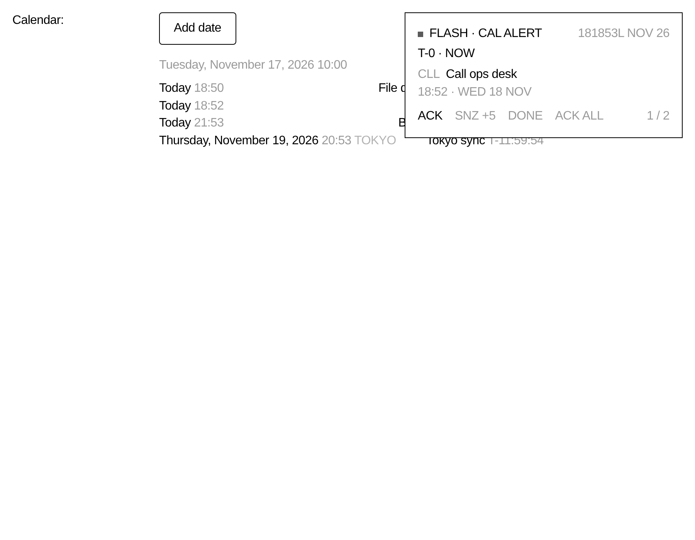
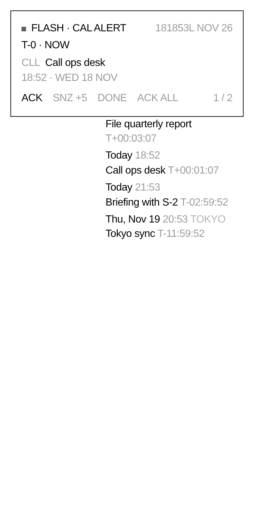
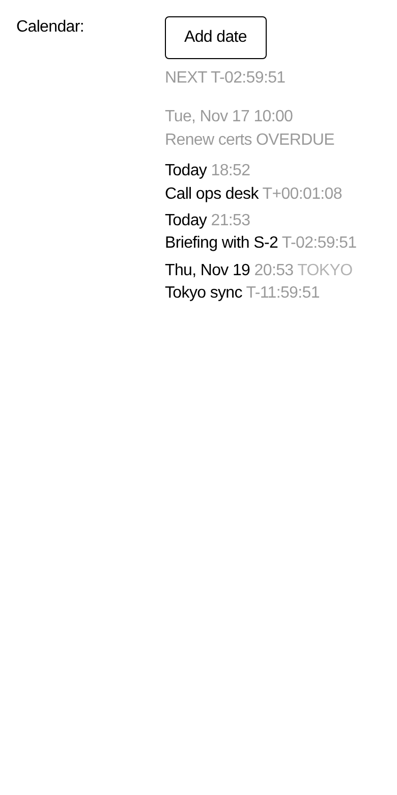

# SESSION REPORT: CALENDAR WIDGET v3 · CALENDAR WATCH + ZONED ALERTS + SNOOZE
## Date: 2026-11-18 · Branch: `claude/dreamy-babbage-dquyif`
### Session type: scheduled routine, autonomous engineering (Calendar widget)

```
╔══════════════════════════════════════════════════════════════════╗
║  LOT SYSTEMS CORPORATION · SESSION REPORT                       ║
║  LOT-SR-20261118-CAL-01 · CALENDAR WIDGET v3                    ║
║  STATUS: GREEN · BUILD PASS · ENGINE 14/14 · WATCH E2E PASS     ║
║          UI HARNESS PASS (desktop + phone, 0 page errors)       ║
╚══════════════════════════════════════════════════════════════════╝
```

---

## 0. READ THIS FIRST: ~30 sessions of Calendar work are spread across ~30 branches

Every earlier run of this routine started from `master` on a new branch, and
none of that work was merged. I found **about 30 `claude/dreamy-babbage-*`
branches** (2026-10-20 → 2026-11-17), each re-implementing "timed entries +
T-15/T-0 alerts" from scratch. `master` still has the 281-line date-only
widget.

**This session broke the loop.** It merged the newest iteration
(`dreamy-babbage-mc3zw1`, Calendar v2, 2026-11-17) into this branch and built
on top of it, rather than starting over again.

**Action for S-2:** merge `claude/dreamy-babbage-dquyif` to `master` (it
contains v2 + v3). Until a Calendar branch is merged, each scheduled run
starts from the old widget. All older `dreamy-babbage-*` Calendar branches are
**SUPERSEDED** and safe to prune.

---

## 1. MISSION

> Continue the Calendar widget. Keep the minimalist UI. Make it a reliable
> widget that tracks time and logs into Log, with military-grade event
> notifications.

**Base state:** Calendar v2 (merged from `mc3zw1`): timed entries, T-15 / T-0 /
DAY alerts, FLASH toast with ACK, done/cancel, OVERDUE lane, `/api/calendar`
stream. Its own "next sortie" list named the biggest reliability gap: **alerts
fired only while a LOT tab was open.**

---

## 2. SITREP: DEFECTS / GAPS ADDRESSED

| # | Gap | Severity | Resolution |
|---|-----|----------|------------|
| G1 | Alerts were logged only if a tab was open at the right minute. With the app closed, the Log had no record of the alert. | **HIGH (reliability)** | **Calendar Watch** (Job 49), a server daemon on a 60s cadence that logs due alerts for every user. |
| G2 | Times were device-local wall clock. A server can't resolve them, and an entry made in NY then viewed in LA fired at the wrong instant. | HIGH (correctness) | Engine is now **zone-aware**: `date + time` resolve in the entry's IANA `tz` (DST-safe). Legacy entries without `tz` keep device-local behaviour. |
| G3 | Two writers (widget + server, or two devices) could log the same alert twice. | MED | Deterministic alert **`key`**, plus an **idempotent `POST /api/logs`** for `calendar_alert` (first write wins, later writers get the existing row back). The daemon re-checks the key right before each write. |
| G4 | An alert fired on one device (or by the server) never surfaced on the others. | MED | `calendar_sync` **SSE push** triggers an immediate refetch. Alerts fired elsewhere within the last 10 min show on this device once (per-device claim). |
| G5 | No snooze; DONE could only be reached from the list. | UX | Toast actions: **`ACK · SNZ +5 · DONE`**, with keys `Enter` / `S` / `D` / `Esc`. Snooze is an append-only `calendar_snooze` event and re-alerts as `SNZ` (FLASH for task/call). |
| G6 | Header countdown clipped at 390px. | Cosmetic | Header row wraps. |
| G7 | **Pre-existing, outside Calendar, NOT fixed**: see §8. | **HIGH** | Reported only. |

---

## 3. ARCHITECTURE

```
                      ┌──────────────────── Log (append-only) ───────────────────┐
                      │ calendar_entry   { date, time?, text, entryType, tz }    │
                      │ calendar_status  { entryId, status }                     │
                      │ calendar_snooze  { entryId, until, minutes }    ◄── NEW  │
                      │ calendar_alert   { key, entryId, phase, priority,        │
                      │                    source: client|watch, firedAt, ... }  │
                      └──────────────────────────────────────────────────────────┘
                          ▲ POST /api/logs (alert = idempotent by key)   ▲ Log.create
                          │                                              │
  ┌───────── WIDGET (any tab/device) ─────────┐        ┌──── CALENDAR WATCH (server, 60s) ────┐
  │ /api/calendar ─► foldCalendar ─► dueAlerts│        │ entries dated UTC D-1..D+1 with tz   │
  │ 1s clock near events / 30s idle           │        │ + their status/snooze/alert rows     │
  │ fires due → logs → toast/pips/OS notif    │        │ ─► foldCalendar ─► dueAlerts ─► log  │
  │ shows alerts fired elsewhere ≤10 min      │◄─SSE───│ sync.emit('calendar_sync', userId)   │
  └───────────────────────────────────────────┘        └──────────────────────────────────────┘
                 shared engine: src/shared/utils/calendar.ts (pure, no DOM / Node)
```

### Alert doctrine (v3)

| Phase | Trigger | Priority | Card |
|-------|---------|----------|------|
| `T-15` | 15 min before a timed entry | IMMEDIATE | auto-clears after 45s |
| `T-0` | at start (grace 60 min) | **FLASH** for task/call · IMMEDIATE for note | FLASH holds until ACK |
| `DAY` | all-day entry, 08:00 **in the entry's zone** | ROUTINE | auto-clears after 15s |
| `SNZ` | at `snoozeUntil` (+5 min) | **FLASH** for task/call · IMMEDIATE for note | holds until ACK |

- Alert key: `entryId:T-15`, `entryId:T-0`, `entryId:DAY`, `entryId:SNZ@<epoch-ms>` (one per snooze).
- If the app opens late, the stale T-15 is suppressed and only T-0 fires. Past the grace window nothing fires, and the entry moves to OVERDUE.
- Done and cancelled entries never alert, and DONE clears a pending snooze.

### Log line (unchanged format, now zone-correct DTG)

```
[FLASH] CAL T-0 · NOW · TSK · Start task · 2026-11-18 18:49 · DTG 181849L NOV 26
[CAL] SNOOZE +5 MIN · CLL · Call ops desk · RE-ALERT 18:57
```

In the Log feed, alerts written by the server show `FLASH · WATCH` in the
`CAL-ALRT:` block. Snoozes render as a `CAL: SNOOZE +5 MIN` block.

---

## 4. UI: MINIMALIST GRAMMAR KEPT

No new colours, fonts or borders. Changes:

- The toast action row adds `SNZ +5` and `DONE` (task/call) in the `text-acc/40` tier.
- A timed entry made in another zone shows a dim city tag: `20:53 TOKYO`.
- The header row wraps on narrow screens.

FLASH card (desktop):



FLASH card (phone, 390px):



Board after SNZ + DONE (phone): the countdown header, OVERDUE lane, T± clocks and zone tag:



---

## 5. FILES

| File | Change |
|------|--------|
| `src/shared/utils/calendar.ts` | **MOVED + EXTENDED** (was `src/client/utils/calendar.ts`): zone math (`wallClock`, `wallToEpoch`, `entryStartMs`), snooze fold, alert keys, `alertMetadata`, `zoneTag`, `SNZ` phase |
| `src/client/utils/calendar.ts` | Re-export shim (keeps `#client/utils/calendar` imports working) |
| `src/server/calendar-watch.ts` | **NEW**: Calendar Watch daemon (Job 49), minute-aligned, overlap-guarded, `CALENDAR_WATCH=off` kill switch, `getCalendarWatchStats()` |
| `src/server/index.ts` | Arms Calendar Watch after the scheduled jobs start |
| `src/server/routes/api.ts` | Idempotent `calendar_alert` POST · `calendar_sync` SSE emit + relay · `calendar_snooze` in stream and displayable events |
| `src/shared/types/index.ts` | `SyncEvents.calendar_sync` |
| `src/client/components/CalendarWidget.tsx` | Shared-engine daemon, cross-device alert surfacing, SSE refetch, snooze, pending-snooze overlay, zone tag, wrap fix |
| `src/client/components/CalendarAlertToast.tsx` | `SNZ +5` / `DONE` actions, keyboard `S` / `D` / `Esc` |
| `src/client/components/Logs.tsx` | `calendar_snooze` renderer · `SNZ` phase label · `WATCH` source tag |
| `scripts/tests/test-calendar-engine.ts` | 8 → **14** assertions (zones incl. DST, zoned DAY, snooze, key round-trip, DTG in zone) |
| `scripts/tests/test-calendar-watch.mjs` | **NEW**: daemon E2E against real Postgres (guarded by `CALENDAR_WATCH_TEST=1`) |
| `scripts/tests/calendar-ui-harness.cjs` | **NEW**: Playwright harness (mocked API) |
| `package.json` | `test:calendar:watch` |

**Backward compatible.** There is no migration (`metadata` is JSONB). Legacy
entries without `tz` still work on the client; the server skips them. Legacy
alert rows without `key` are keyed from `entryId:phase`.

---

## 6. VERIFICATION

```
yarn build                          client ✓ · server tsc ✓ (0 errors) · ESM fix ✓
yarn test:calendar                  CALENDAR ENGINE: 14/14 GREEN
  └─ re-run under TZ=Asia/Tokyo, America/Los_Angeles, UTC → 14/14 each
test:calendar:watch (Postgres 16)   CALENDAR WATCH E2E: GREEN
  ├─ T-15 logged for NY call at +10 min
  ├─ T-0 logged as FLASH, source=watch, DTG line format verified
  ├─ stale T-15 suppressed
  ├─ SNZ re-alert logged at snooze time
  ├─ legacy (no tz) entry skipped · done entry skipped
  ├─ calendar_sync SSE event emitted
  └─ second tick fires 0 (idempotent)
UI harness (Chromium, NY zone)      desktop 900px + phone 390px, 0 page errors
  ├─ client fires T-0 FLASH → exactly one calendar_alert POST (key e1:T-0)
  ├─ server-fired alert (e2:T-0, source=watch) shown as card 2/2, NOT re-logged
  ├─ SNZ +5 → calendar_snooze POST with until = now+5m
  └─ DONE → calendar_status done; entry leaves the board
tsc --noEmit (client)               104 errors before = 104 after (all pre-existing; none in calendar files)
```

The JSONB filters were run against real Postgres: `metadata#>>'{date}' IN (...)`,
`metadata#>>'{entryId}' IN (...)` and `metadata#>>'{key}' = ...`.

**Not verified:** `POST /api/logs` dedupe and `GET /api/calendar` through a
running authenticated server. Both use the same query shapes the E2E exercised.

---

## 7. KNOWN LIMITS / NEXT SORTIE

1. **Closed-app delivery to the operator.** The Log now always records the alert, but a *notification* still reaches the user only when a tab is open (toast) or the OS notification permission is granted in an open tab. Next step: Service Worker + Web Push (VAPID) sent by Calendar Watch, or an email for FLASH alerts.
2. **Multiple server instances** each run Calendar Watch. The re-check before each write prevents duplicates in practice, but there is no DB-level unique constraint. Hardening option: a partial unique index on `(userId, metadata->>'key') WHERE event='calendar_alert'`.
3. **Edit / reschedule** is not built yet. Proposed append-only form: a `calendar_edit { entryId, date?, time?, text? }` event folded like status.
4. **Recurrence** (daily / weekly) was built on an older branch (`ln0dzm`) against the v1 engine. Port it onto the v3 engine.
5. **Snooze presets** are fixed at +5. A `SNZ +15` second preset is a one-line add if wanted.

---

## 8. ⚠ PRE-EXISTING DEFECT FOUND (outside Calendar, NOT fixed)

`src/server/scheduled-jobs.ts` uses **90 dynamic imports** of the form
`import('#server/models/log.js')`. `package.json#imports` maps
`#server/models/*` → `./dist/server/server/models/*.js`, so at runtime they
resolve to **`log.js.js`** and throw `ERR_MODULE_NOT_FOUND`. I reproduced this
against the compiled `dist`: `#server/models/log.js` fails and
`#server/models/log` loads.

**Impact:** every scheduled job that uses these imports (47× `log.js`,
38× `user.js`, plus `utils/email.js`, `utils/monthly-summary.js`,
`utils/energy.js` and two `utils/memory/*`) most likely throws inside its
try/catch and **silently does nothing in production**. That includes the
monthly email job. The same pattern exists 5× for `#server/utils/ai-engines.js`
in `routes/api.ts` and `routes/public-api.ts`.

**Why it is not fixed here:** the fix is mechanical (drop the `.js`), but it
would switch on ~40 background jobs that have been dormant, including jobs
that **send email to users**, in an unattended session. Calendar Watch uses
the correct form (`#server/models/log`). **Recommend S-2 review it, then apply
the fix:**

```
sed -i "s|import('\(#server/[^']*\)\.js')|import('\1')|g" \
  src/server/scheduled-jobs.ts src/server/routes/api.ts src/server/routes/public-api.ts
```

---

## 9. LEDGER LINE

```
2026-11-18 | CAL-v3 | dreamy-babbage-dquyif | GREEN | +Calendar Watch (Job 49) · zoned engine · idempotent alerts · SSE · SNZ/DONE | engine 14/14 · watch E2E · UI harness
```

```
END OF REPORT · LOT-SR-20261118-CAL-01 · GREEN
```
