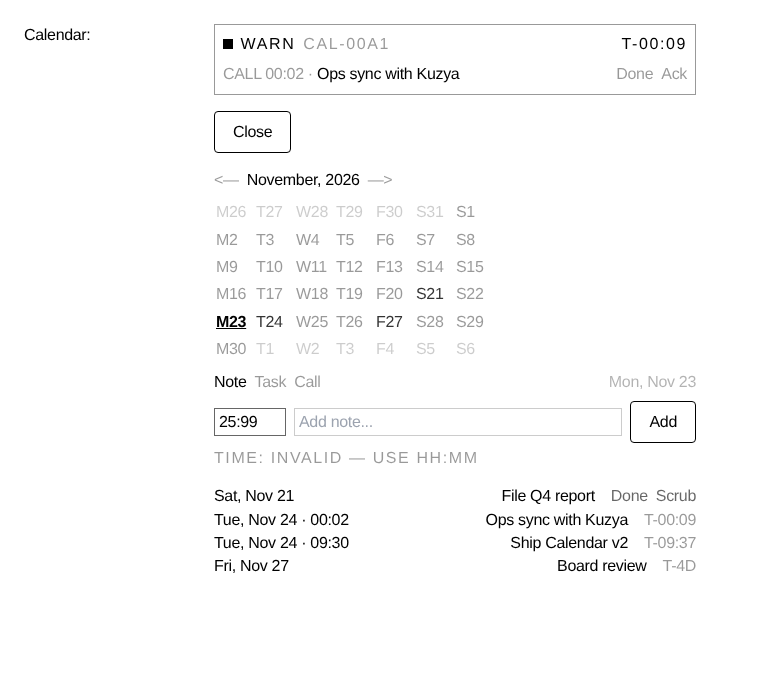

```
================================================================================
LOT SYSTEMS / SESSION REPORT
DOCUMENT: LOT-SR-20261123-01
TITLE:    CALENDAR v2 — time tracking · Log integration · military alerts
CLASS:    RESTRICTED // S-2 EYES
S-2:      VADIK MARMELADOV
BRANCH:   claude/dreamy-babbage-mg6giw
DATE:     2026-11-23
TIME:     23:55 UTC
MODE:     SCHEDULED ROUTINE (autonomous, unattended)
RESULT:   GREEN
================================================================================
```

## 00 // PREFLIGHT

```
REPO:          OK (clean tree on claude/dreamy-babbage-mg6giw @ 9f2b88c)
DEPS:          yarn install --frozen-lockfile  OK
TYPECHECK BASE: tsc --noEmit -p tsconfig.json → 104 errors (pre-existing,
               none in calendar code — badges.ts / Logs.tsx L99 etc.)
```

## 01 // INTAKE

```
ARTIFACT:        Scheduled directive — "continue the Calendar widget; keep the
                 minimalist UI; reliable widget that tracks time and logs into
                 Log with stylish military-grade event notifications."
CLASSIFICATION:  ENGINEERING / UI DETAIL
FOUNDATION:      src/client/components/CalendarWidget.tsx (281 lines, date-only,
                 note/task/call, entries as calendar_entry logs)
```

## 02 // RECON — DEFECTS FOUND IN THE FOUNDATION

| #  | Defect | Impact |
|----|--------|--------|
| D1 | Widget read entries from `GET /api/logs`, which is capped at **500 rows** | An entry planned months ahead silently disappears once 500 newer logs exist |
| D2 | `/api/logs` returns **only notes** when `hideActivityLogs` is on | Calendar is **empty** for every operator with activity logs hidden |
| D3 | `getMonthWeeks` built months via `dayjs().year(y).month(m)` | On the 29th–31st, month navigation overflows (e.g. Feb → March grid) |
| D4 | Input cleared **before** the server confirmed the write | Network failure = entry text lost, no signal to operator |
| D5 | `today` computed once per render; no clock | Left open across midnight → "today", upcoming list stale |
| D6 | List keyed by array index; entries had no identity | No way to close / complete / reference an entry |
| D7 | No time-of-day, no countdown, no alerting | Widget did not "track time" at all |
| D8 | `refetchQueries(['/api/logs'])` after every add | Full 500-row Log refetch per entry |

## 03 // ACTIONS — WHAT SHIPPED

### A. Calendar core — `src/client/utils/calendar.ts` (NEW, pure, testable)
- Append-only event model; entry state = fold of status events over entries:
  ```
  calendar_entry   { date, time?, text, entryType }          create
  calendar_done    { entryId, ref, date, text, entryType, onTime }  complete
  calendar_cancel  { entryId, ref, date, text, entryType }   scrub
  calendar_alert   { entryId, ref, phase, date, time?, text, entryType, firedAt }
  ```
- `normalizeTime` — accepts `9`, `930`, `9:30`, `0930` → `HH:MM`; rejects `24:00`, `12:60`.
- `entryRef(id)` — operator reference code `CAL-XXXX` (last 4 of log id).
- `countdown()` — military format: `T-3D 04H` · `T-02:11` · `T+00:05` · `T+2D` · `D-DAY`.
- `dueAlerts()` — two-phase alerting: **WARN at T-15**, **ALERT at T-0** (untimed: 09:00 local on the day). Stale guard: alerts older than 60 min never fire (reopening the app days later does not flood the Log). If both phases are due, only T-0 fires.
- `getMonthWeeks()` — always anchored on the 1st (fixes D3).

### B. Server — `src/server/routes/api.ts`
- **NEW `GET /api/calendar`** — all `calendar_*` events for the user, newest first, limit 2000, minimal columns. Independent of the 500-row Log window and of `hideActivityLogs` (fixes D1, D2).
- `calendar_done`, `calendar_cancel`, `calendar_alert` added to the `/api/logs` displayable whitelist so they appear in the Log.

### C. Client query — `src/client/queries.ts`
- `useCalendarFeed()` (+ `CalendarFeedLog` type), 60s stale, refetch on focus.

### D. Widget — `src/client/components/CalendarWidget.tsx` (rewritten on the same layout)
- **Clock**: 15s tick + refresh on tab focus (fixes D5).
- **Time field**: optional `HH:MM` beside the text input; invalid input blocks Add and shows `TIME: INVALID — USE HH:MM`.
- **Upcoming list**: `Tue, Nov 24 · 09:30   Ship Calendar v2   T-09:37` — live countdown, right-aligned, low-opacity; overdue goes full-contrast. Open tasks stay visible up to 7 days overdue.
- **Close an entry**: tap a row → `Done` / `Scrub` (text buttons, no icons). Writes `calendar_done` / `calendar_cancel`; entry leaves the list; day view shows `CMPL` / struck-through `SCRB`.
- **Alert banner** (military-grade, minimalist): thin `acc/40` border, square indicator (pulses at T-0), `WARN|ALERT · CAL-XXXX · T-00:09`, type/time line, `Done` / `Ack`. `role="alert"`, `aria-live="assertive"`.
- **System notification**: fires a native `Notification` only if permission was **already granted** — never prompts.
- **Write reliability** (fixes D4, D8): input cleared only on `onSuccess`; failure shows `TX FAILED — ENTRY NOT RECORDED. RETRY.`; created logs are inserted straight into the calendar cache (`setQueryData`) and `/api/logs` is invalidated (not force-refetched). Alert/status writes use `mutateAsync` on a separate mutation channel so concurrent writes each resolve.
- **Alert de-duplication**, three layers: server-logged alerts (feed) ∪ localStorage ledger (cross-tab, bounded 300) ∪ session ref. A failed alert write releases its key so the next tick retries; the banner is shown once per session regardless.
- Month header gains a `Today` jump when off-month; clicking an off-month date switches to that month; button reads `Close` while open. Feed-offline state with `retry`.

### E. Log — `src/client/components/Logs.tsx`
| Event | Label | Body |
|-------|-------|------|
| `calendar_entry` | `CAL:` | `TASK … CAL-7F3A` / text / `2026-11-24 · 09:30` |
| `calendar_alert` | `CAL-ALRT:` | `■ ALERT · T-0 … CAL-7F3A` / text / `CALL · 2026-11-24 · 14:00` |
| `calendar_done` | `CAL-CMPL:` | `TASK · CLOSED` (or `CLOSED LATE`) / text / date |
| `calendar_cancel` | `CAL-SCRB:` | `TASK · SCRUBBED` / struck text / date |

Log text prefixes: `[CAL]`, `[CAL-ALRT]`, `[CAL-CMPL]`, `[CAL-SCRB]`.

### F. System header — `src/client/components/System.tsx`
- "Next:" block now reads the calendar feed, excludes done/scrubbed entries, and shows the time when set: `Tue, November 24 · 09:30 — Ship Calendar v2 (+2 more)`.

### G. Tests — `scripts/tests/test-calendar.ts` + `yarn test:calendar`
34 assertions: time normalization, date validation, ref codes, month-grid overflow regression, status folding, ordering, countdown formats (incl. a caught off-by-one on overdue rounding), alert scheduling, stale suppression, T-0 supersedes T-15, untimed 09:00 alert.

## 04 // GATE

```
COMMAND                                   RESULT
-------                                   ------
yarn test:calendar                        34 passed · 0 failed
tsc --noEmit -p tsconfig.json             104 errors = baseline 104 (0 new)
yarn client:build  (esbuild + tailwind)   PASS
yarn server:build  (tsc + esm fix)        PASS
Headless render (Playwright, mocked feed) PASS — banner, grid, time field,
                                          invalid-time, countdowns, Done/Scrub
FIX LOG:  countdown overdue rounding (Math.floor on negative minutes → +1 min)
          fixed before gate; alert retry re-showing ACKed banners fixed.
GATE:     GREEN
```



## 05 // FILES

```
M  src/client/components/CalendarWidget.tsx   widget rewrite (same layout)
A  src/client/utils/calendar.ts               pure calendar core
M  src/client/components/Logs.tsx             CAL / CAL-ALRT / CAL-CMPL / CAL-SCRB
M  src/client/components/System.tsx           Next: block via calendar feed
M  src/client/queries.ts                      useCalendarFeed
M  src/server/routes/api.ts                   GET /api/calendar + whitelist
M  package.json                               test:calendar script
A  scripts/tests/test-calendar.ts             34-assertion verification
A  docs/benchmark/LOT-SR-20261123-01.md       this report
A  docs/benchmark/img/LOT-SR-20261123-01-calendar.png
```

No migrations. No schema change. Backward compatible: old `calendar_entry` rows (no `time`) render as untimed entries.

## 06 // KNOWN LIMITS / NEXT SESSION

1. **Alerts are client-side.** They fire only while a LOT tab is open (any tab, any widget page that mounts System). Server-side alerting (scheduled job writing `calendar_alert` + push) is the next step for true unattended reliability.
2. **Cross-device duplicate window.** Two devices open at the same minute can both log the same alert before either sees the other's write (feed stale ≤60s). Low impact; a server-side unique check on `(userId, entryId, phase)` would close it.
3. **No edit / reschedule.** Reschedule = scrub + re-add. An `calendar_move` event fits the model cleanly.
4. **Time zone** is the browser's local zone at render time; entries store wall-clock `HH:MM`, not an instant. Correct for a personal planner; travel across zones shifts alerts to local wall time.
5. **Pre-existing, out of scope — flagged:** `PUT /api/logs/:id` (api.ts ≈L1616) looks up the log by id **without checking `log.userId === req.user.id`**. It only edits `note` events, but any signed-in user who knows a note id could overwrite or delete it. Recommend a one-line ownership guard.
6. About.tsx wiki "Calendar" section still states "no time slots" and "does not push notifications" — doctrine text needs a v2 sync.

## 07 // LEXICON

```
T-15     pre-alert (WARN) phase, 15 min before a timed entry
T-0      due-moment (ALERT) phase; untimed entries: 09:00 local on D-DAY
D-DAY    untimed entry whose date is today
CAL-XXXX operator reference code of an entry (last 4 of log id)
CMPL     entry closed as complete      SCRB  entry scrubbed (cancelled)
ACK      dismiss a banner without changing the entry
```

## 08 // DOCTRINE

- The Log is the source of truth; calendar state is a **fold**, never a mutation.
- A widget that plans the future must not read from a window that forgets the past — give it its own feed.
- Never clear operator input before the server confirms the write.
- Alerts must be idempotent across tab, session and device, and must never fire stale.

```
================================================================================
END OF REPORT // LOT-SR-20261123-01 // GREEN
================================================================================
```
