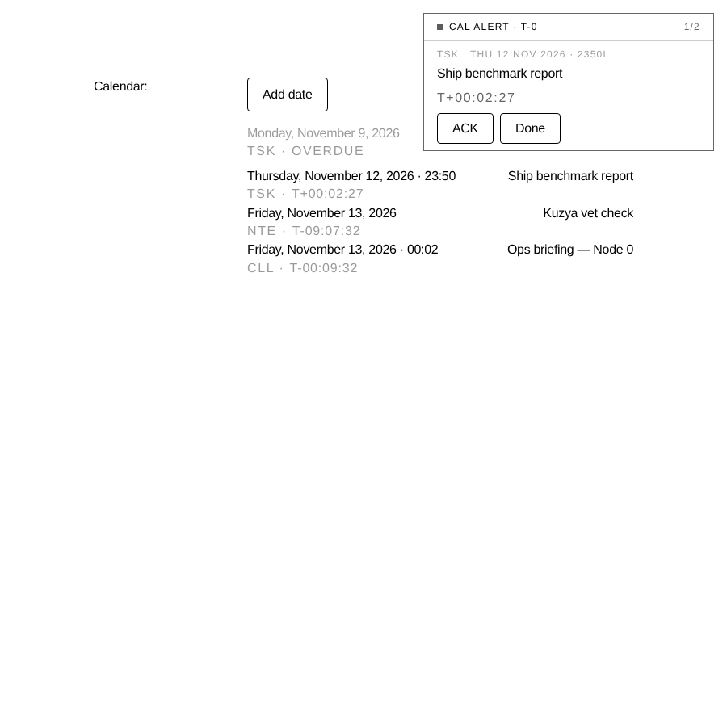
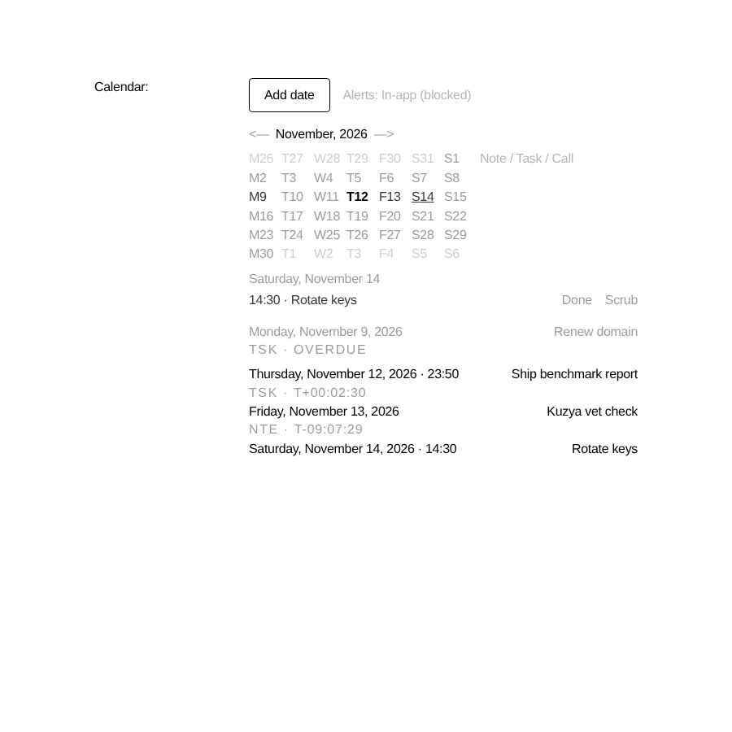

# CALENDAR · SESSION REPORT · 2026-11-12 · SR-01

```
┌──────────────────────────────────────────────────────────────────────┐
│ LOT SYSTEMS · CALENDAR WIDGET · SESSION REPORT                       │
│ DTG ........ 2026-11-12                                              │
│ BRANCH ..... claude/dreamy-babbage-9j5o01                            │
│ MODE ....... Scheduled routine (autonomous)                          │
│ STATUS ..... GREEN · build PASS · engine tests 30/30 · 0 new TS errs │
└──────────────────────────────────────────────────────────────────────┘
```

## 1 · Mission

Build on the existing Calendar widget so it reliably tracks time, writes into
Log, and raises military-style event notifications, while keeping the
minimal UI.

## 2 · Starting state

| Area | Before |
|---|---|
| Entries | `calendar_entry` log with `{date, text, entryType}`. No time of day. |
| Lifecycle | None. Entries could not be completed or cancelled. Every past entry stayed forever. |
| Data source | `/api/logs`, which is capped at 500 rows **and** filtered to notes only when `hideActivityLogs` is on, so calendar entries could silently disappear. |
| Notifications | None. |
| Log rendering | `CAL:` block showing type and date only. |
| System "Next:" | Raw log filter. It ignored status and time. |

## 3 · Delivered

### 3.1 Event-sourced calendar engine: `src/client/utils/calendar.ts`
Logs are append-only (the server only lets `note` logs be edited), so the
calendar is built by folding three Log events:

| Event | Metadata | Purpose |
|---|---|---|
| `calendar_entry` | `{date, time?, text, entryType}` | Schedule an entry. **Entry id = log id**, so older entries keep working without migration. |
| `calendar_status` | `{entryId, status: done\|scrubbed\|scheduled}` | Complete, scrub or reopen an entry. Status events are applied in `createdAt` order and the latest one wins. |
| `calendar_alert` | `{entryId, stage: T-15\|T-0}` | Alert receipt. Each alert is logged to Log and also prevents the same alert firing twice across devices. |

The engine is pure and has no dependencies: date/time validation, flexible
24h time parsing (`9:05`, `1430`, `7`), ordering (all-day entries first, then
by time), `upcoming`, `overdue`, `pendingAlert`, `nextAlertBoundary` and
military formatters (`T-2D 04H`, `T-03:12:09`, `T+00:04:10`, `1430L`).

### 3.2 Dedicated feed: `GET /api/calendar`
- Returns every `calendar_*` event for the user (up to 2000 rows).
- It does **not** depend on the `/logs` 500-row window or on `hideActivityLogs`.
- Client hook `useCalendarLogs` polls every 2 minutes and refetches on focus, so changes made on other devices show up here.
- `calendar_status` and `calendar_alert` were added to the `/logs` displayable events, so they show in Log.

### 3.3 Shared hook: `src/client/hooks/useCalendar.ts`
- `addEntry`, `setStatus` and `logAlert` add a **provisional row** to the cache first, so the UI and alert dedupe react before the server responds. If the write fails, the row is removed.
- `isReady` is set once any feed data has arrived. A later failed refetch keeps the cached data, so **a network error does not stop alerts**. (Bug found and fixed during this session: the first version gated alerts on `isError`.)
- `useNow(ms)` is a ticker that pauses while the tab is hidden.

### 3.4 Alert monitor: `src/client/components/CalendarAlerts.tsx`
- Mounted **once at the app root** (`entries/app.tsx`). The System tab unmounts when you leave it, so this is what lets alerts fire on every tab.
- **Timed entries** get a `CAL WARN · T-15` at 15 minutes before and a `CAL ALERT · T-0` when due.
- **All-day entries** get a T-0 at 09:00 local time.
- **Late open:** if the app opens up to 6 hours after the due time, T-0 is still delivered once. If both stages are pending, only T-0 fires.
- **Three layers of dedupe:**
  1. Server receipts (`calendar_alert`) cover other devices.
  2. A localStorage claim covers other tabs. It is swept after 3 days.
  3. The provisional cache row covers re-renders.
- Panel: monospace-style uppercase header, a solid status pip that **blinks on T-0**, `TSK · THU 12 NOV 2026 · 2349L`, a live countdown, and **ACK** / **Done** buttons. Several alerts queue up with a `1/N` counter. A T-0 replaces an open T-15 for the same entry. Alerts close themselves if the entry is closed on another device.
- **Native notifications** go out only when the tab is hidden and permission has been granted ("armed"). T-0 uses `requireInteraction`.
- **Audio** plays only when the global sound setting is on: square-wave pips, 2 × 880 Hz for T-15 and 3 × 1320 Hz for T-0.
- A precise `setTimeout` is set to the next alert boundary, in addition to the 15 s scan (1 s while an alert is on screen).

### 3.5 Widget: `src/client/components/CalendarWidget.tsx` (minimal layout kept)
- **Optional `HH:MM` field** next to the entry text. Invalid times show an inline error and nothing is saved. Enter submits, Esc cancels.
- Upcoming rows show `· 14:30` and, within 24 h, a live `TYPE · T-hh:mm:ss` countdown line. Only that line re-renders each second.
- Tapping a row shows **Done / Scrub**. In the selected-day view, closed entries are dimmed and can be **reopened**.
- **Overdue**: unclosed entries from the last 7 days appear dimmed with `TSK · OVERDUE`. Older entries stay hidden so legacy data doesn't create noise.
- Clicking the month title returns to the current month. Clicking a day from the previous or next month moves to that month.
- An `Alerts: Armed / In-app` control asks for notification permission.
- Below the `sm` breakpoint, rows stack vertically. The old `whitespace-nowrap` caused horizontal overflow on phones.

### 3.6 Log rendering: `Logs.tsx`
`CAL:` (entry), `CAL-STAT:` (COMPLETE / SCRUBBED / REOPENED) and `CAL-ALRT:` (T-15 / T-0). Each shows the type code, the text, and the date with `HHMM L` or `ALL-DAY`.

### 3.7 System "Next:"
This now uses the engine, so it respects status and shows the time. Timed
entries drop off one hour after they are due.

## 4 · Verification

| Check | Result |
|---|---|
| `yarn test:calendar` (new, 30 assertions) | **30 PASS · 0 FAIL** in both America/Los_Angeles and Asia/Tokyo |
| `yarn build` (client + server) | **PASS** |
| `tsc --noEmit` | 104 errors before and 104 after. **0 new**; all existing errors are in other files. |
| Browser harness (Playwright, real components, `/api/*` mocked at the network layer) | See below |

**Harness run:**
- **On load:** `calendar_alert:T-0` (entry due 2 minutes ago) and `calendar_alert:T-15` (entry due in 10 minutes) were each posted to Log exactly once.
- **ACK** moved to the next queued alert.
- **Done** posted `calendar_status:done`, and the alert and the row cleared.
- **`25:00`** was rejected with the inline error. **`1430`** was saved as `14:30`.
- **Reload with localStorage cleared:** 0 alerts fired again, because the server receipts held.
- **Mobile (390 px):** rows stack and nothing scrolls horizontally.





## 5 · Files

```
A  src/client/utils/calendar.ts            engine (pure)
A  src/client/hooks/useCalendar.ts         data + actions + ticker
A  src/client/components/CalendarAlerts.tsx global alert monitor
A  scripts/tests/test-calendar.ts          engine self-test (yarn test:calendar)
M  src/client/components/CalendarWidget.tsx
M  src/client/components/Logs.tsx          CAL / CAL-STAT / CAL-ALRT blocks
M  src/client/components/System.tsx        "Next:" via engine
M  src/client/entries/app.tsx              mount <CalendarAlerts/>
M  src/client/queries.ts                   useCalendarLogs
M  src/server/routes/api.ts                GET /api/calendar · displayable events
M  package.json                            test:calendar script
```

No schema change and no migration. Legacy `calendar_entry` rows load as
all-day `scheduled` entries.

## 6 · Known limits and risks

1. **Alerts need an open LOT tab.** There is no service worker or server push yet. A closed browser means alerts are missed, though T-0 is still delivered for up to 6 hours after the app is opened again.
2. **Times are in the viewer's local timezone.** The entry does not store a timezone, so on a device in another zone the same entry fires at that zone's wall-clock time.
3. Native notifications only appear when the tab is **hidden**. While the tab is visible, the in-app panel is used. This is intentional.
4. Entries cannot be edited (Log is append-only). The workaround is to scrub the entry and add it again.
5. The feed is capped at 2000 calendar events per user. That is plenty for now; paginate it if it is ever reached.

## 7 · Next sessions (proposed order)

1. **Server-side alerts:** a scheduled job writes `calendar_alert` at T-0 and sends Web Push through a service worker, so alerts arrive with the browser closed. Store `tz` on new entries.
2. **Snooze** (`+10M`, `+1H`) as a `calendar_status: snoozed` event with `{until}`.
3. **Recurring entries** (`daily`, `weekdays`, `weekly`), expanded in the engine.
4. **Time tracking:** a start/stop session on a task (`calendar_track` start/stop events), with elapsed time logged to Log and a daily total.
5. **Edit entry** as a `calendar_status: amended` event with new fields, folded in the engine.
6. Commit the Playwright harness as `scripts/tests/calendar-visual.cjs` so the UI can be checked again quickly.

```
END OF REPORT · CALENDAR-SR-20261112-01 · GREEN
```
