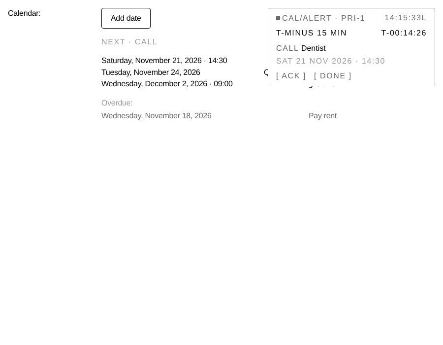
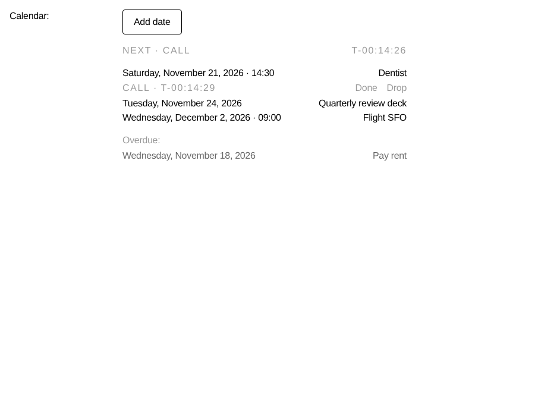
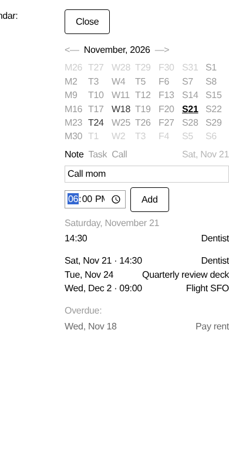

# LOT-SR-20261121-CALENDAR-S01 — Calendar Widget: Time Tracking + Alerts

```
SESSION      CALENDAR-S01            DATE     2026-11-21
BRANCH       claude/dreamy-babbage-wxofhj
MODE         Scheduled routine (unattended)
STATUS       GREEN  ·  build ok  ·  0 new TS errors  ·  16/16 tests
```

## 1. Objective

Make the Calendar widget reliable: track time, write every action to the Log, and show event alerts in a terse, military-style format. Keep the existing minimalist UI.

## 2. Starting point

`src/client/components/CalendarWidget.tsx` (281 lines) could create date-only `calendar_entry` logs and list upcoming ones. Gaps found:

| # | Gap | Severity |
|---|-----|----------|
| G1 | Entries were read from `/api/logs`, which is capped at **500 rows**. Once a user had 500 newer logs, older calendar entries silently disappeared. | HIGH |
| G2 | `getMonthWeeks` built months with `dayjs().year(y).month(m)`. On the 29th–31st this overflows (for example, Feb becomes March), so the grid showed the wrong month. | HIGH |
| G3 | No time of day, so nothing could be tracked or alerted on. | — |
| G4 | No lifecycle: entries could not be marked done or dropped, and past entries stayed "upcoming" until their date passed. | MED |
| G5 | No notifications. | — |
| G6 | Rapid Enter could double-submit, because the input stayed enabled while saving. | LOW |
| G7 | At phone width the "Note / Task / Call" link and long dates ran past the right edge of the screen. | LOW |

## 3. What shipped

### 3.1 Data model (everything stays in the Log)

| Event | Metadata | Purpose |
|-------|----------|---------|
| `calendar_entry` | `date`, `time?` (HH:mm, local), `text`, `entryType` | Create. Backward compatible: old date-only rows still load. |
| `calendar_status` | `refId`, `status` (`done`/`cancelled`/`open`), plus a copy of the entry | Done / Drop / Reopen. The latest status row wins. |
| `calendar_alert` | `refId`, `phase` (`T-15`/`T-0`/`DAY`), plus a copy of the entry | One row per alert fired. These rows also stop the same alert firing on a second device. |

There is no migration and no schema change. Entry id = the id of its `calendar_entry` log row.

### 3.2 Server — `src/server/routes/api.ts`
- **New `GET /api/calendar`** returns only the three calendar events: the newest 5000, oldest first. This fixes **G1**.
- `calendar_status` and `calendar_alert` were added to the `/logs` list of events that are shown, so status changes and alerts appear in the Log tab.

### 3.3 Core logic — `src/client/utils/calendar.ts` (new, pure functions)
- `buildEntries` folds the rows into entries and applies the latest status.
- Sort order: by date, then timed entries by time, then all-day entries.
- Alert windows:
  - **T-15**: from 15 minutes before the time until the time. Skipped if the entry was created inside that window.
  - **T-0**: from the time until 30 minutes after.
  - **DAY**: for all-day entries, from 09:00 to the end of the day. Skipped if the entry was created after 09:00 that day.
- `dueAlerts` returns only the latest open window for each entry, so a laptop waking at T+2 gets one T-0 alert, not an old T-15 as well.
- Overdue rules: a timed entry is overdue 30 minutes after its time; an all-day entry is overdue once its day ends.
- `formatCountdown` gives `T-04:12:09` under a day, `T-3D 04H` beyond that, and `T+…` once past.

### 3.4 Alert watcher + panel — `src/client/hooks/useCalendar.ts`, `src/client/components/CalendarAlerts.tsx` (new)
- **Mounted once at the app root** (`entries/app.tsx`), so alerts fire on every tab. The System tab is unmounted when inactive, so a watcher inside the widget would miss them.
- It checks every 15 seconds, sets an exact timer when the next window opens in under 15 seconds, and checks again when the tab becomes visible, so it catches up after sleep.
- Duplicate protection has three layers: `calendar_alert` rows on the server, `localStorage` (wrapped in try/catch), and an in-memory set.
- Alert card layout: `CAL/ALERT · PRI-n`, local clock `HH:MM:SSL`, phase line, live T-minus, type + text, date stamp, `[ ACK ]` `[ DONE ]`.
  - Priority: call = PRI-1, task = PRI-2, note = PRI-3.
  - Esc acknowledges the newest alert. At most 3 alerts stack.
  - Pip blink and slide-in animations; both turn off under `prefers-reduced-motion`.
- Sound: two square-wave pips, played **only if LOT sound is on**.
- OS notification: shown **only if permission was already granted and the tab is hidden**. The app never asks for permission.
- Marking an entry done or dropped clears its alert on screen, including when it is closed from another device.

### 3.5 Widget — `CalendarWidget.tsx`
- Same layout and type styles. New pieces:
  - optional **time** field;
  - a `NEXT · TYPE   T-00:14:26` status line, ticking once a second only when the next entry is within 24 hours;
  - tap a row to see its type, countdown, and **Done / Drop** (or **Reopen**);
  - an **Overdue:** section (up to 5);
  - a Loading / "Calendar offline." empty state.
- The month grid is built from the 1st of the month (fixes **G2**). Only open entries highlight a date.
- Add is disabled while saving and while the time is invalid (fixes **G6**). Text is limited to 280 characters.
- Phone width: short dates (`Sat, Nov 21 · 14:30`), the form wraps, and the "Note / Task / Call" link moves below the grid (fixes **G7**).

### 3.6 Log tab — `Logs.tsx`
One renderer handles all three events: `CAL:`, `CAL/STATUS:`, `CAL/ALERT:`. Each shows a header line, the entry text, and `date · time`.

## 4. Verification

| Check | Result |
|-------|--------|
| `tsc -p tsconfig.json` (client) | 0 new errors. The 128 existing errors are unchanged, compared against a stashed baseline. |
| `tsc -p tsconfig.server.json` | clean |
| `yarn build` | exit 0 |
| `yarn test:calendar` (new, `scripts/tests/test-calendar.ts`) | **16/16 PASS**: sorting, latest status wins, invalid dates dropped, T-15/T-0/DAY windows, duplicate protection, stale alert after grace period, created-inside-window skip, overdue, countdown format, validators |
| Playwright harness (widget + alerts with mocked `/api`, clock fixed at 2026-11-21 14:15:30) at 900px and 390px | T-15 fired **once** → 1 `calendar_alert` POST. ACK dismissed the card. Done → `calendar_status` POST with correct `refId`. Adding a timed entry → `calendar_entry` with `time: "18:00"`. No page errors. |

Screenshots:

| Alert (desktop) | Row actions | Entry form (390px) |
|---|---|---|
|  |  |  |

## 5. Known limits / next session

1. **Alerts need an open LOT tab.** There is no server push or service worker yet. Next step: have a scheduled job (`scheduled-jobs.ts`) write `calendar_alert` rows on the server, plus a Web Push channel.
2. Entries cannot be edited (text or time) yet. The plan is a `calendar_edit` event using the same fold pattern.
3. No repeating entries (daily or weekly). This needs care so duplicate protection keeps working.
4. The lead time is fixed at 15 minutes. It could become a per-entry or per-user setting.
5. Times are the user's local wall clock. An entry made in one time zone fires at the same wall-clock time after travel. This is intended for now.
6. The harness used a mocked API, so the new `/api/calendar` query was not tested against a live database. The query is simple, but run one manual check on staging.

## 6. Files

```
M  src/server/routes/api.ts                 GET /api/calendar · log events shown in /logs
M  src/client/queries.ts                    useCalendar
A  src/client/utils/calendar.ts             core logic (pure)
A  src/client/hooks/useCalendar.ts          data, actions, alert watcher, $calendarAlerts
A  src/client/components/CalendarAlerts.tsx alert panel
M  src/client/components/CalendarWidget.tsx widget v2
M  src/client/components/Logs.tsx           CAL / CAL/STATUS / CAL/ALERT renderers
M  src/client/entries/app.tsx               mount <CalendarAlerts/>
A  scripts/tests/test-calendar.ts           16 unit tests
M  package.json                             test:calendar script
A  docs/calendar/…                          this report + screenshots
```
